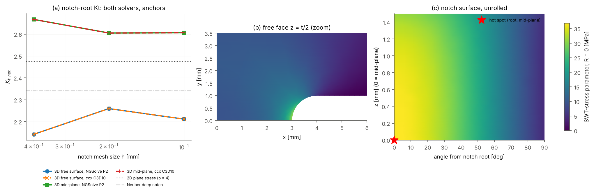

# Toolchain check: NGSolve P2 vs CalculiX C3D10 -> critical-plane search

Ezeh & Susmel (2020) intermediate notch (U, r = 1 mm), 3D 1/8 model, PLA E = 3476 MPa, nu = 0.33. Identical straight-sided tetrahedra and mid-edge nodes for both solvers (same discrete space, exact stiffness integration), nodal stresses averaged over elements in both. Net-section amplitude 10 MPa. 4 CPU cores.

## 1. FE agreement and mesh convergence

| notch h [mm] | vertices | DOF NGSolve / ccx | NGSolve solve [s] | ccx solve [s] | ccx write+read [s] | max dU / U | max dS / S | Kt_net surface NGS / ccx | Kt_net mid-plane NGS / ccx |
|---|---|---|---|---|---|---|---|---|---|
| 0.40 | 413 | 6156 / 6156 | 0.10 | 0.19 | 0.02 | 2.8e-06 | 1.1e-05 | 2.142 / 2.142 | 2.667 / 2.667 |
| 0.20 | 1356 | 23979 / 23979 | 0.38 | 1.24 | 0.06 | 2.8e-06 | 1.2e-05 | 2.260 / 2.260 | 2.605 / 2.605 |
| 0.10 | 4485 | 85977 / 85977 | 2.72 | 7.00 | 0.23 | 2.8e-06 | 1.4e-05 | 2.212 / 2.212 | 2.606 / 2.606 |

Anchors: 2D plane stress on the curved geometry (notch edge h = 0.03 mm), Kt_net = 2.4717 (p = 2), 2.4749 (p = 3), 2.4749 (p = 4); ligament force / applied = 1.00002. Neuber deep hyperbolic notch (a = 3, rho = 1 mm): 2.340. 3D brackets plane stress: mid-plane (constrained) above, free surface below.

**Note:** the earlier elasticity_rhmp EFFM study (fakasht10/codex) reported Kt_net 4.18 / 4.02 for this notch; an independent audit traced that to its root-stress recovery (nodal force / line weight). The anchors here hold.

frd stress components (checked against cplane order): SXX, SYY, SZZ, SXY, SYZ, SZX

## 2. Critical-plane results on the free-surface nodes (finest mesh)

| R | criterion | max damage param. NGS [MPa] | ccx [MPa] | rel. diff | max field diff / max | same hot-spot node | normal diff [deg] | hot-spot normal (x, y, z) | tau_a / sn_a / sn_m [MPa] | search [s] | screened [s] (points) |
|---|---|---|---|---|---|---|---|---|---|---|---|
| -1 | Findley k=0.3 | 17.5005 | 17.5004 | 5.1e-06 | 1.3e-05 | yes | 0.00 | (-0.59, 0.81, 0.00) | 12.48 / 16.74 / -0.00 | 0.044 | 0.006 (256 of 2181) |
| -1 | MWCM | 13.0267 | 13.0266 | 4.9e-06 | 1.3e-05 | yes | 0.00 | (-0.71, -0.70, 0.00) | 13.03 / 13.00 / 0.00 | 0.041 | 0.006 (256 of 2181) |
| -1 | SWT-stress | 26.0619 | 26.0616 | 1.2e-05 | 1.4e-05 | yes | 0.00 | (0.01, 1.00, 0.00) | 0.00 / 26.06 / 0.00 | 0.029 | 0.005 (256 of 2181) |
| 0 | Findley k=0.3 | 22.9921 | 22.9920 | 5.1e-06 | 1.4e-05 | yes | 0.00 | (-0.49, 0.87, 0.00) | 11.17 / 19.70 / 19.70 | 0.042 | 0.007 (256 of 2181) |
| 0 | MWCM | 13.0267 | 13.0267 | 4.9e-06 | 1.3e-05 | yes | 0.00 | (-0.71, -0.70, 0.00) | 13.03 / 13.00 / 13.00 | 0.042 | 0.011 (256 of 2181) |
| 0 | SWT-stress | 36.8571 | 36.8566 | 1.2e-05 | 1.4e-05 | yes | 0.00 | (0.01, 1.00, 0.00) | 0.00 / 26.06 / 26.06 | 0.050 | 0.006 (256 of 2181) |

Mesh convergence of the hot-spot damage parameter (NGSolve, Findley k = 0.3, R = -1): h 0.40: 17.8601, h 0.20: 17.5937, h 0.10: 17.5005 MPa.

