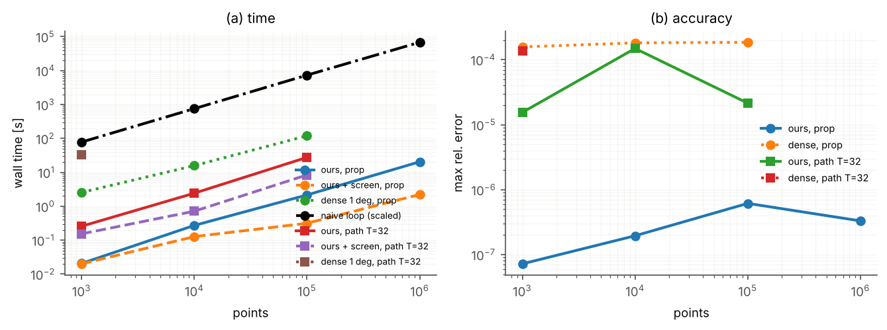

# Critical-plane kernel: speed and accuracy (cplane.py)

Findley (k = 0.3). Synthetic log-normal-scaled stress fields; 4 CPU cores, FP64. Times in seconds, errors are the max relative error of the damage parameter vs a converged reference (prop: 8000 coarse normals, 8 candidates, tol 1e-7; path: brute force on 200 000 normals, first 200 points). Defaults: 800 (prop) / 400 (path) coarse normals, 4 local maxima refined to 2e-4 rad. `naive` = Python loop, 2 deg grid, timed on 30 points and scaled. `dense` = vectorised 1 deg grid (20 600 normals). `screen 0.5` = exact search only where the upper bound exceeds 0.5 x worst damage.

| loading | points | naive [s] | naive err | dense 1deg [s] | dense err | **ours [s]** | **ours err** | ours+screen [s] | points searched | worst point kept |
|---|---|---|---|---|---|---|---|---|---|---|
| prop | 1,000 | 77.9 | 0.000481 | 2.55 | 0.000157 | **0.0206** | **7.21e-08** | 0.02 | 1,000 | yes |
| prop | 10,000 | 753 | 0.000522 | 15.7 | 0.000182 | **0.272** | **1.95e-07** | 0.127 | 4,096 | yes |
| prop | 100,000 | 7.32e+03 | 0.000344 | 119 | 0.000186 | **2.15** | **6.14e-07** | 0.315 | 4,096 | yes |
| prop | 1,000,000 | 6.81e+04 | 0.000538 | - | - | **20.4** | **3.3e-07** | 2.23 | 4,096 | yes |
| path T=32 | 1,000 | - | - | 33.6 | 0.000136 | **0.257** | **1.55e-05** | 0.153 | 512 | yes |
| path T=32 | 10,000 | - | - | - | - | **2.42** | **0.000149** | 0.713 | 512 | yes |
| path T=32 | 100,000 | - | - | - | - | **27.6** | **2.15e-05** | 8.38 | 512 | yes |

Throughput (proportional, full field): 4.9e+04 points/s; naive: 15 points/s.

