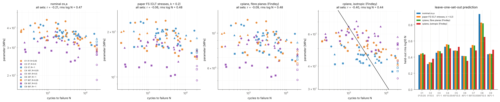

# Non-proportional multiaxial fatigue of CFRP tubes (Duda et al. 2025): critical-plane correlation

Data: Duda, Smolnicki, Lesiuk, Fatemi, Arch. Civ. Mech. Eng. 25 (2025) 212 (CC BY), Table 4: 104 thin-walled [+-30] CFRP tubes, 9 sets = R (-1, 0.05, 0.5) x phase (0, 45, 90 deg), tau_xy,a = sigma_x,a, 14 run-outs. Ply stresses by linear CLT (Table 1 lamina properties); the paper used a nonlinear FE critical point.

Check: cplane on fibre-containing planes with Findley k = 0.1 reproduces the paper's parameter / 2 to 3.4e-05 (the shear path on the fibre plane is 1D, so MCC = range / 2).
Linear CLT, unit sigma_x = tau_xy (independent of R): ply +30: sigma_1 3.32, sigma_2 -0.201, tau_12 -0.146 (|tau_12/sigma_2| 0.73); ply -30: sigma_1 -1.04, sigma_2 -0.079, tau_12 0.270 (|tau_12/sigma_2| 3.42). **sigma_2 is compressive in both plies** (laminate Poisson effect), so k sigma_2,max <= 0 for positive R and the paper's parameter cannot work with CLT stresses; the fibre-plane fit of k hits its lower bound 0 (Findley requires k >= 0) - a constrained, not a true, optimum. The paper's nonlinear FE critical point has lambda_12 = 0.35 / 0.25 / 0.18 (R = -1 / 0.05 / 0.5) with tensile sigma_2. Membrane-only CLT also ignores the B16/B26 coupling of the two-layer +-30 wall and the ~25 % through-wall variation of torsional shear (t / R_m = 0.22).

Fitted Findley k (max |r| on positive-R sets, in-sample): fibre planes 0.00, isotropic 0.20.

## Correlation (Basquin on failures): Pearson r / rms log10 N (in-sample for the fitted-k rows)

| parameter | paper subset C1 C2 C7 C8 | positive R (6 sets) | all 9 sets |
|---|---|---|---|
| nominal σx,a | -0.16 / 0.48 | -0.22 / 0.48 | -0.21 / 0.47 |
| paper FS (CLT stresses, k = 0.2) | 0.03 / 0.48 | -0.06 / 0.50 | -0.06 / 0.48 |
| cplane, fibre planes (Findley) | 0.01 / 0.48 | -0.08 / 0.49 | -0.09 / 0.48 |
| cplane, isotropic (Findley) | -0.57 / 0.40 | -0.46 / 0.44 | -0.40 / 0.44 |
| *ceiling: best \|r\| of ANY load-proportional parameter (free scale per set)* | *0.77* | *0.67* | *0.62* |

Paper (nonlinear FE stresses, C1 C2 C7 C8): r = 0.84.

**Why every correlation is weak.** Within a set the stress range is narrow (e.g. 24-30 MPa) and life scatters over 1-2 decades. Any parameter proportional to the load at fixed R and phase (all stress-based critical-plane parameters with linear stresses: Findley, MCC, Walker are degree-1 homogeneous) is one scale factor per set, so its pooled |r| cannot exceed the ceiling row (0.77 paper subset, 0.62 all sets; with run-outs included 0.75 / 0.68; even one free power law per set: 0.79).

**The paper's r values are not comparable.** Its Table 3 within-set r differ from Table 4 recomputed (log N on log sigma_a, failures): C1 0.94 vs 0.85, C2 0.84 vs 0.83, C3 0.75 vs 0.72, C4 0.45 vs 0.81, C5 0.51 vs 0.27, C6 0.17 vs 0.28, C7 0.81 vs 0.72, C8 0.84 vs 0.71, C9 0.63 vs 0.28. Run-outs included, linear or semi-log variants do not reproduce them either, so the paper computes r differently or on different data (ref. [16]); its 0.84 cannot be benchmarked against this ceiling.

**Which physics.** Shear-based Findley on the applied stresses correlates best in-sample (k = 0.1-0.2); out of sample (k re-selected per fold) its gain over the nominal stress is small (see LOSO). Normal-stress parameters do not: isotropic Walker r over all sets for gamma 0 / 0.25 / 0.5 / 0.75 / 1 = 0.21 / 0.21 / 0.21 / 0.17 / 0.05. Consistent with shear-driven matrix-fibre debonding (paper Sect. 3).

## Leave-one-set-out prediction: rms log10 N (bias) of the held-out set; fitted k re-selected inside each fold

| set | phase | R | nominal σx,a | paper FS (CLT stresses, k = 0.2) | cplane, fibre planes (Findley) | cplane, isotropic (Findley) |
|---|---|---|---|---|---|---|
| C1 | 0 | 0.05 | 0.43 (+0.28) | 0.44 (+0.22) | 0.45 (+0.25) | 0.43 (+0.35) |
| C2 | 0 | 0.5 | 0.31 (-0.06) | 0.34 (-0.00) | 0.33 (+0.01) | 0.38 (+0.25) |
| C3 | 0 | -1 | 0.45 (+0.07) | 0.48 (+0.01) | 0.47 (+0.03) | 0.45 (-0.13) |
| C4 | 45 | 0.05 | 0.53 (-0.07) | 0.56 (-0.09) | 0.55 (-0.09) | 0.51 (-0.10) |
| C5 | 45 | 0.5 | 0.48 (-0.14) | 0.48 (-0.10) | 0.48 (-0.09) | 0.53 (+0.26) |
| C6 | 45 | -1 | 0.41 (+0.22) | 0.41 (+0.20) | 0.41 (+0.20) | 0.35 (-0.05) |
| C7 | 90 | 0.05 | 0.51 (-0.02) | 0.55 (-0.02) | 0.54 (-0.04) | 0.48 (-0.03) |
| C8 | 90 | 0.5 | 0.93 (-0.84) | 0.83 (-0.69) | 0.82 (-0.68) | 0.65 (-0.51) |
| C9 | 90 | -1 | 0.44 (+0.10) | 0.44 (+0.08) | 0.44 (+0.06) | 0.49 (-0.26) |
| **mean** | | | **0.50** | **0.50** | **0.50** | **0.47** |

