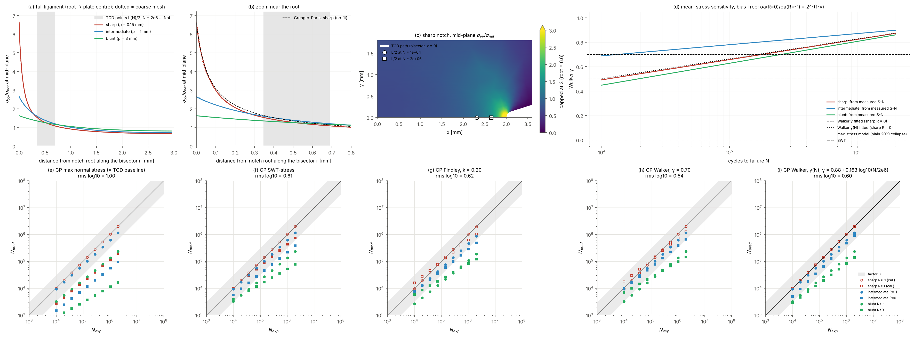

# Critical plane + TCD point method on notched AM PLA (Ezeh & Susmel 2020) - R = 0 column read as amplitude

**Data:** Ezeh & Susmel, IJF 136 (2020) 105583, Table 1 S-N curves (net amplitude; 3 raster angles averaged in log space; PS 50 %), plain reference sigma_MAX = 6.7 MPa at 2e6, k = 5.1. 9 lives per case, 1e4-2e6.
**Model:** 3D 1/8 plate, NGSolve P2, stresses on the notch bisector at the mid-plane (hot spot); critical plane searched at every point (cplane). **Protocol:** L(N) calibrated on the sharp notch at R = -1 against the plain curve, separately for each criterion; Findley k fitted on the sharp notch at R = 0; everything else is predicted. Error index E = P_eff / P_ref - 1 at the measured life (Susmel's band +-20 %); life factor N_pred / N_exp at the measured stress.

## 1. Models

| notch | rho [mm] | DOF (coarse / fine) | Kt_net mid-plane (coarse / fine) | Kt_net free surface (fine) |
|---|---|---|---|---|
| sharp | 0.15 | 44708 / 140069 | 6.708 / 6.602 | 4.512 |
| intermediate | 1 | 23742 / 72180 | 2.667 / 2.638 | 2.200 |
| blunt | 3 | 60675 / 220746 | 1.630 / 1.625 | 1.536 |

Path / field checks (fine mesh): the TCD path is the notch bisector y = 0 at the mid-plane z = 0, from the root (x = 3 mm) to the plate centre (x = 0); sigma_yy along it is maximal at the root for every notch. Ligament force / (net area x unit net stress) = sharp 0.9990, intermediate 1.0003, blunt 1.0001 (equilibrium; Gauss quadrature of the FE stress over the y = 0 face). Sharp notch near the root vs Creager-Paris blunt-crack field sigma_yy ~ r'^-1/2 (1 + rho / 2r'), r' = r + rho/2 (no fitted constant, scaled by the FE root value): max deviation 2 % for r <= rho.

Mesh sensitivity of the parameter at the calibrated L/2 (all criteria, notches, N = 1e4 and 2e6), coarse vs fine: max 4.1e-03. The TCD point lies 0.2-0.7 mm from the root, where the mesh is converged; Kt itself moves 1.6 % (sharp).

## 2. Calibrated critical distance and prediction accuracy (predictions only)

| criterion | constant | L(N) = A N^B [mm] | L at 1e4 / 2e6 | rms log10 life factor | mean log10 (bias; > 0 = non-conservative) | lives within factor 3 | E within +-20 % | mean E | **rms log10, common 4 cases** |
|---|---|---|---|---|---|---|---|---|---|
| CP max normal stress (= TCD baseline) | - | 4.51 N^-0.129 | 1.38 / 0.70 | 1.00 | -0.86 | 20 % | 20 % | +67 % | **1.04** |
| CP SWT-stress | - | 4.51 N^-0.129 | 1.38 / 0.70 | 0.61 | -0.49 | 51 % | 36 % | +33 % | **0.67** |
| CP Findley | k = 0.20 (fit, sharp R = 0) | 4.82 N^-0.160 | 1.11 / 0.48 | 0.62 | -0.54 | 47 % | 28 % | +35 % | **0.62** |
| CP Walker | γ = 0.70 (fit, sharp R = 0) | 4.51 N^-0.129 | 1.38 / 0.70 | 0.54 | -0.44 | 56 % | 47 % | +28 % | **0.54** |
| CP Walker, γ(N) | γ = 0.88 +0.163 log10(N/2e6) (fit, sharp R = 0) | 4.51 N^-0.129 | 1.38 / 0.70 | 0.60 | -0.51 | 50 % | 50 % | +28 % | **0.60** |

Ezeh & Susmel's own L(N) (2D, max principal): 16.4 N^-0.242 mm.

## Why R = 0 separates the criteria: mean-stress sensitivity

Measured notched fatigue strength at 2e6, amplitude ratio R = 0 / R = -1 (Table 1, per raster angle): sharp 1.05, 0.81, 0.90; intermediate 0.90, 0.92, 0.98; blunt 0.89, 1.03, 0.82 -> mean 0.92 (range 0.81-1.05). Implied by each criterion for a uniaxial state at equal parameter: max stress 0.50, SWT 0.71, Findley k = 0.2 0.83 (k = 0: 1.00). Notched AM PLA is nearly mean-stress insensitive in amplitude, so the max-stress (and to a lesser degree SWT) reference over-penalises R = 0. The 2019 finding that sigma_MAX collapses the *plain* data does not carry over to these notched specimens.

**Systematic blunt-notch bias (all criteria, both R, life factor 0.12-0.19):** the blunt notch is stronger (net section) than the plain specimens of the 2019 campaign (Kf < 1; elasticity_rhmp NOTCH_SCALING in fakasht10/codex). No notch method anchored to that plain curve can predict it; a batch/size issue, not a critical-plane issue.

## 3. Per case (mean life factor N_pred / N_exp over 1e4-2e6; mean E)

| notch | R | role | CP max normal stress (= TCD baseline) | CP SWT-stress | CP Findley | CP Walker | CP Walker, γ(N) |
|---|---|---|---|---|---|---|---|
| sharp | -1 | calibration | 1 x (E +0 %) * | 1 x (E +0 %) * | 1 x (E -0 %) * | 1 x (E +0 %) * | 1 x (E +0 %) * |
| sharp | 0 | prediction | 0.16 x (E +61 %) | 0.62 x (E +14 %) | 0.92 x (E +3 %) * | 1.1 x (E -1 %) * | 1 x (E -0 %) * |
| intermediate | -1 | prediction | 0.73 x (E +8 %) | 0.73 x (E +8 %) | 0.54 x (E +17 %) | 0.73 x (E +8 %) | 0.73 x (E +8 %) |
| intermediate | 0 | prediction | 0.083 x (E +88 %) | 0.32 x (E +33 %) | 0.43 x (E +24 %) | 0.56 x (E +16 %) | 0.47 x (E +16 %) |
| blunt | -1 | prediction | 0.19 x (E +45 %) | 0.19 x (E +45 %) | 0.16 x (E +52 %) | 0.19 x (E +45 %) | 0.19 x (E +45 %) |
| blunt | 0 | prediction | 0.026 x (E +131 %) | 0.12 x (E +63 %) | 0.19 x (E +47 %) | 0.22 x (E +42 %) | 0.14 x (E +42 %) |

\* calibration case for that criterion (sharp R = -1 for all; sharp R = 0 also for Findley and both Walker variants).

Constant scans (rms log10 life factor on the sharp notch, R = 0): Findley k 0.00: 0.40, k 0.20: 0.16, k 0.40: 0.32, k 0.60: 0.46, k 0.80: 0.55, k 1.00: 0.61; Walker γ 0.00: 0.80, γ 0.20: 0.57, γ 0.40: 0.35, γ 0.60: 0.17, γ 0.80: 0.20, γ 1.00: 0.39.

Is the constant a material property? Fitted on each notch alone at R = 0: findley sharp 0.20, intermediate 0.00, blunt 0.00; walker sharp 0.70, intermediate 0.90, blunt 1.00. Walker γ = 1 means the normal-stress amplitude alone (no mean-stress effect).

Bias-free Walker γ per notch: for Walker the R = 0 parameter is exactly 2^(1-γ) x the R = -1 parameter at every point, so at equal life sigma_a(R=0) / sigma_a(R=-1) = 2^-(1-γ), independent of L(N) and of the R = -1 calibration bias. From the measured S-N curves (raster-averaged):

| notch | γ at N = 1e4 | 1e5 | 2e6 |
|---|---|---|---|
| sharp | 0.49 | 0.66 | 0.87 |
| intermediate | 0.69 | 0.78 | 0.90 |
| blunt | 0.45 | 0.63 | 0.86 |

The per-notch fits above drift because the intermediate and blunt R = 0 fits also absorb those notches' R = -1 bias. The bias-free gamma is NOT a material constant: it rises with life and differs between notches at short life (and per raster angle it spans ~0.7-1.07 at 2e6, outside Walker's [0, 1] range). gamma(N): with raster-averaged power laws gamma_free is linear in log N by construction, so its exact fit on sharp R = 0 is a tautology, not overfitting; constant gamma scores better only because its error offsets the N-dependent R = -1 notch-transfer bias.

**Reference curve.** P_ref uses the plain R = -1 curve only (sigma_MAX = 6.7 MPa at 2e6, k = 5.1). If the 2019 finding (sigma_MAX collapses plain R = 0 and R = -1) holds, criteria fitted here to the notched R = 0 data would mispredict plain R = 0 specimens (parameter 0.6 x the reference, ~12 x non-conservative in life). Not tested: no plain R = 0 data in the repo.

**Evidence base.** The 'points' are 9 samples of each fitted median S-N curve (raster-averaged), not individual tests; effectively 5 predicted curves. The life range 1e4-2e6 is assumed, not taken from the paper.

**Table 1 R = 0 interpretation: amplitude** (unverified; see CP_TCD_PLA_RMAX.md for the other reading).

