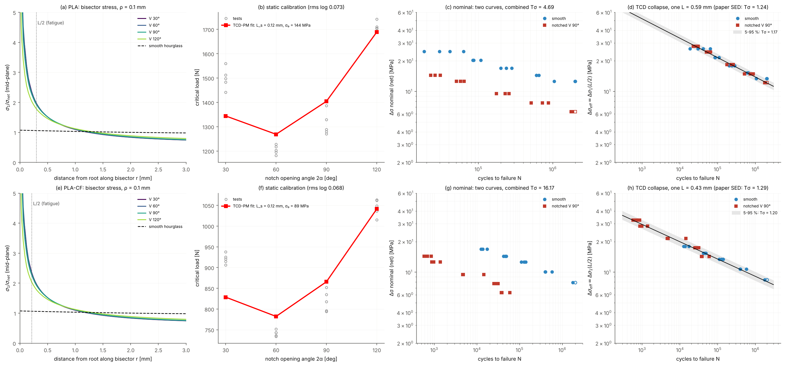

# Blind notch-fatigue prediction and data collapse: Valean et al. (TAFM 131, 2024) PLA and PLA-CF

Data: Valean, Foti, Berto, Marsavina, Theor. Appl. Fract. Mech. 131 (2024) 104417 (CC BY), Tables 2-4: static V-notch critical loads (2a = 30/60/90/120 deg, 5 each) and individual fatigue results (15 smooth + 15 notched 2a = 90 deg, R = 0.1; same printing parameters, smooth fatigue data from the authors' earlier study [39]). Model: 3D 1/8, NGSolve P2, max principal stress at the mid-plane on the bisector; root radius not reported -> rho = 0.1 mm (sensitivity 0.05 / 0.2 mm). Static calibration (sigma_0, L_s) on the 4 angles; notched fatigue then predicted blind from the smooth curve with L_s.

## 1. Checks

| material | geometry | DOF | Kt (sigma1, net) | ligament force / net load |
|---|---|---|---|---|
| PLA | V 30 deg, rho 0.10 | 69292 | 10.14 | 0.9972 |
| PLA | V 60 deg, rho 0.10 | 67894 | 10.11 | 0.9985 |
| PLA | V 90 deg, rho 0.10 | 55240 | 9.58 | 0.9982 |
| PLA | V 120 deg, rho 0.10 | 56851 | 7.41 | 0.9991 |
| PLA | smooth hourglass R 45 | 7215 | 1.075 | 1.0000 |
| PLA-CF | V 30 deg, rho 0.10 | 69292 | 10.14 | 0.9972 |
| PLA-CF | V 60 deg, rho 0.10 | 67894 | 10.11 | 0.9985 |
| PLA-CF | V 90 deg, rho 0.10 | 55240 | 9.58 | 0.9982 |
| PLA-CF | V 120 deg, rho 0.10 | 56851 | 7.41 | 0.9991 |
| PLA-CF | smooth hourglass R 45 | 7215 | 1.075 | 1.0000 |

Mesh sensitivity of sigma1 at L/2 (fatigue L, V 90, rho 0.1, coarse vs fine): PLA 3.5e-03, PLA-CF 7.9e-04.

## 2. Static TCD calibration (4 angles x 5 tests)

| material | rho [mm] | L_s [mm] | sigma_0 [MPa] (UTS) | rms log load | F_pred / F_exp: 30 / 60 / 90 / 120 deg |
|---|---|---|---|---|---|
| PLA | 0.05 | 0.30 | 91.5 (41.6) | 0.093 | 0.90 / 1.12 / 1.07 / 0.93 |
| PLA | 0.10 | 0.12 | 143.8 (41.6) | 0.073 | 0.90 / 1.05 / 1.07 / 0.99 |
| PLA | 0.20 | 0.10 | 152.9 (41.6) | 0.079 | 0.89 / 1.08 / 1.06 / 0.98 |
| PLA-CF | 0.05 | 0.30 | 56.4 (33.5) | 0.088 | 0.90 / 1.12 / 1.05 / 0.94 |
| PLA-CF | 0.10 | 0.12 | 88.6 (33.5) | 0.068 | 0.90 / 1.05 / 1.06 / 1.00 |
| PLA-CF | 0.20 | 0.10 | 94.3 (33.5) | 0.074 | 0.89 / 1.08 / 1.04 / 0.99 |

Paper's SED control radius: PLA R0 = 0.81 mm (static), 0.91-0.97 mm (fatigue); PLA-CF 0.30 / 0.52-0.69 mm.

## 3. Fatigue: collapse, split-sample prediction, static-L blind prediction

| material | rho | T_sigma nominal (smooth+notched) | T_sigma TCD, L optimised (L) | **same, paper's convention** | paper SED T_sigma | T_sigma smooth alone / notched alone | split test: long-life notched predicted, rms log10 / mean / within x3 (L) | static-L blind: rms log10 / mean / within x3 | T_sigma with static L |
|---|---|---|---|---|---|---|---|---|---|
| PLA | 0.05 | 4.69 | 1.17 (0.58 mm) | **1.28** | 1.24 | 1.21 / 1.11 | 0.10 / +0.07 / 100 % (0.60 mm) | 0.70 / -0.70 / 0 % | 1.85 |
| PLA | 0.10 | 4.69 | 1.17 (0.59 mm) | **1.28** | 1.24 | 1.21 / 1.11 | 0.10 / +0.06 / 100 % (0.61 mm) | 1.75 / -1.75 / 0 % | 9.60 |
| PLA | 0.20 | 4.69 | 1.17 (0.63 mm) | **1.28** | 1.24 | 1.21 / 1.11 | 0.10 / +0.06 / 100 % (0.65 mm) | 1.93 / -1.93 / 0 % | 14.43 |
| PLA-CF | 0.05 | 16.17 | 1.20 (0.41 mm) | **1.35** | 1.29 | 1.09 / 1.27 | 0.25 / +0.10 / 100 % (0.45 mm) | 0.54 / -0.49 / 47 % | 1.30 |
| PLA-CF | 0.10 | 16.17 | 1.20 (0.43 mm) | **1.35** | 1.29 | 1.09 / 1.27 | 0.25 / +0.10 / 100 % (0.48 mm) | 1.75 / -1.74 / 0 % | 2.30 |
| PLA-CF | 0.20 | 16.17 | 1.20 (0.45 mm) | **1.35** | 1.29 | 1.09 / 1.27 | 0.25 / +0.10 / 100 % (0.50 mm) | 1.96 / -1.95 / 0 % | 2.57 |

**Scatter-index convention.** Our T = 10^(2 x 1.645 s); on the paper's own nominal curves it gives values systematically below the paper's (ratio of logs per curve: 1.62, 1.64, 1.67, 1.56; least-squares exponent 1.59), i.e. the paper uses a wider quantile or a different estimator. Converted to the paper's convention, one fatigue L collapses smooth + notched about **as well as, or slightly worse than, the paper's SED** (PLA ~1.29 vs 1.24, PLA-CF ~1.36 vs 1.29) - not better.

**What the collapse is.** With a single fatigue notch geometry, the optimised L acts as a fitted fatigue notch factor (T_opt is identical for every assumed rho): it shows that one constant reconciles smooth and notched data, not that TCD transfers between notch geometries. The split test splits by stress level within the same geometry: a same-geometry extrapolation check (mostly that smooth and notched slopes are similar, 5.43 vs 5.10 for PLA), not a prediction for a new notch.

**Static calibration works; static -> fatigue transfer of L does not, as expected.** The linear-elastic point method with (sigma_0, L_s) fitted on the 4 angles reproduces the static loads to ~7 % rms, including the minimum at 60 deg (comparable to the paper's SED, +-7 %); sigma_0 > UTS is normal for linear-elastic TCD on polymers. But L_s is not identifiable with the root radius unknown (0.10-0.30 mm for rho 0.2-0.05) and L is life-dependent (the paper's own R0 grows from static to fatigue: 0.81 -> 0.97 mm PLA, 0.30 -> 0.69 mm PLA-CF), so using L_s for high-cycle fatigue is not a valid TCD prediction - TCD does not claim it.

Nominal Basquin fits (ours vs paper, log10 N = a - k log10 dS): PLA smooth 12.09 / 5.43 (paper 12.11 / 5.45), notched 10.34 / 5.10 (paper 10.31 / 5.07); PLA-CF smooth 12.13 / 6.45 (paper 12.14 / 6.47), notched 9.10 / 5.43 (paper 9.09 / 5.42).

